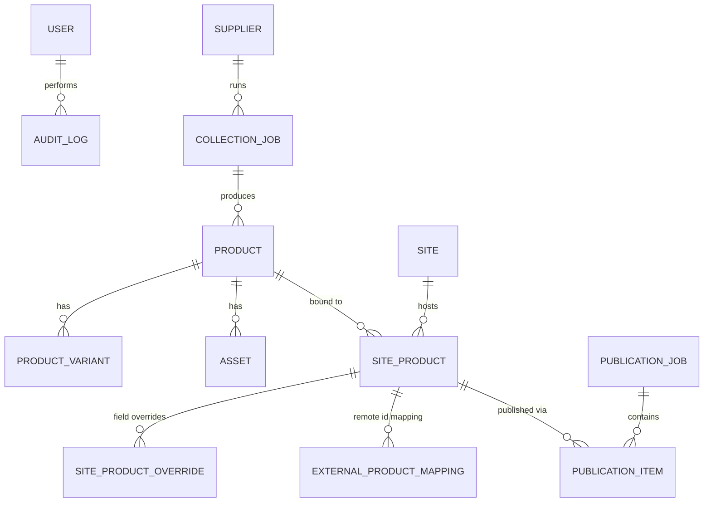

# 多供应商采集与多站点商品发布管理后台

内部管理后台:多供应商商品采集、AI 标题/描述/图片处理、多站点(Shopify/WooCommerce/WordPress)商品发布与审核。

## 技术栈

- 前端:React + TypeScript + Vite + React Router + Tailwind CSS v4 + TanStack Query/Table + Zustand + React Hook Form + Zod
- 后端:FastAPI + SQLAlchemy(异步)+ Alembic + PostgreSQL + Redis + Celery

## 本地启动

### 依赖服务(PostgreSQL / Redis)

```bash
sudo service postgresql start
redis-server --daemonize yes
createdb app_db        # 开发库
createdb app_test_db   # 测试库(pytest 用)
```

### 后端

```bash
cd backend
python3 -m venv venv
./venv/bin/pip install -r requirements.txt
cp .env.example .env   # 按需修改,生产环境必须换掉 JWT_SECRET_KEY
./venv/bin/alembic upgrade head
./venv/bin/uvicorn app.main:app --reload --port 8000
```

首次启动后,用以下接口创建第一个管理员账号(只能成功一次):

```bash
curl -X POST http://localhost:8000/api/v1/auth/bootstrap-admin \
  -H "Content-Type: application/json" \
  -d '{"email":"admin@example.com","password":"一个强密码","full_name":"管理员"}'
```

运行测试:

```bash
cd backend
./venv/bin/python -m pytest tests/ -v
```

### 前端

```bash
cd frontend
npm install
npm run dev   # http://localhost:5173, /api 自动代理到 :8000
```

## 架构概览



核心原则:**内部商品(Product)与站点上的商品(SiteProduct)严格分离**,改一个站点的覆盖字段(SiteProductOverride)不会动到内部主数据或其它站点。详见 `.claude` 项目总指令(本仓库开发依据)。

## 开发阶段状态

| 阶段 | 内容 | 状态 |
|---|---|---|
| 0 | 现状检查与规划 | ✅ 完成 |
| 1 | 项目基础设施(认证、权限、布局、健康检查) | ✅ 完成,见下方"阶段 1 验收结果" |
| 2 | 商品中心 | ⏳ 未开始 |
| 3 | 多站点基础 | ⏳ 未开始 |
| 4 | 第一个真实发布连接器(建议 WooCommerce) | ⏳ 未开始,需要测试站点凭据 |
| 5 | 采集与 AI | ⏳ 未开始 |
| 6 | 其他站点连接器 | ⏳ 未开始 |
| 7 | 稳定性与交付 | ⏳ 未开始 |

### 阶段 1 验收结果

- PostgreSQL 16 / Redis 7 本地已安装并跑通,数据库迁移(Alembic)已生成并应用
- 认证:邮箱+密码,JWT access/refresh 双令牌,bcrypt 哈希
- 角色:admin / operator / reviewer / readonly,后端 `require_roles` 依赖强制校验(不依赖前端隐藏按钮)
- 自动化测试:`backend/tests/test_auth.py` 共 7 个用例,全部通过(`pytest -v` 结果见 CI 日志/终端输出)
- 前端:登录页 + 受保护路由 + 侧边栏布局骨架,已通过 `tsc --noEmit` 和 `vite build`,并与后端真实联调验证(bootstrap-admin → login → /auth/me 全链路通过 Vite 代理跑通)
- 其余业务模块页面目前是**明确标注"未实现"的占位页**,不展示虚构数据,等待阶段 2+

### 已知限制 / 需要你决策的事项

1. **WooCommerce vs Shopify**:阶段 4 建议先做 WooCommerce(REST API + 测试站点更容易获取)。需要你提供一个测试站点的 URL + Consumer Key/Secret,或确认改用 Shopify(需要 Partner 账号)。
2. **部署目标**:当前代码在沙箱容器里开发和测试,容器不持久化。需要你提供实际的 Git 仓库地址(+ 具备 push 权限的方式),后续每阶段我会 commit 并告知你如何同步到你自己的机器/服务器。
3. **S3 兼容存储**:图片资源阶段 2 就需要用到,需要你提供 Bucket + Access Key(或确认先用本地文件系统模拟,生产再切换)。
